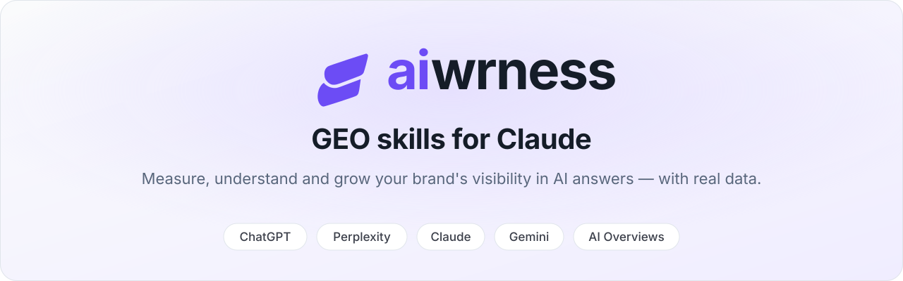
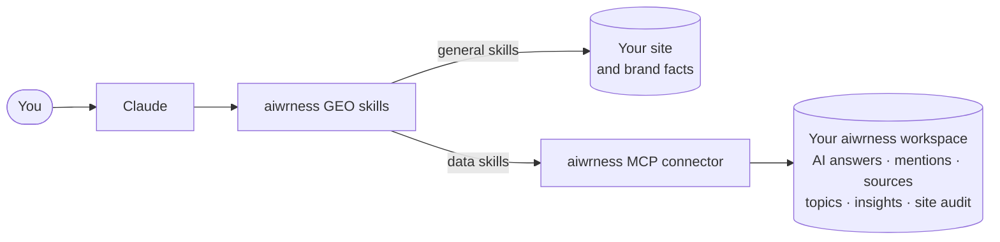

<p align="center">
  <a href="https://aiwrness.com">
    <picture>
      <source media="(prefers-color-scheme: dark)" srcset="assets/banner-dark.svg">
      
    </picture>
  </a>
</p>

<p align="center">
  <strong>The GEO toolkit for Claude that works with your real AI visibility data — not guesses.</strong><br>
  Prepare your brand, site and content for AI assistants, then measure what ChatGPT, Perplexity, Claude, Gemini and Google AI Overviews actually say.
</p>

<p align="center">
  <a href="#-quick-start"></a>
  <a href="#-the-skills"></a>
  <a href="#-how-it-works"></a>
  
</p>

<p align="center">
  <a href="#-quick-start">Quick start</a> ·
  <a href="#-try-asking">Try asking</a> ·
  <a href="#-the-skills">Skills</a> ·
  <a href="#-how-it-works">How it works</a> ·
  <a href="#-principles">Principles</a> ·
  <a href="#-faq">FAQ</a> ·
  <a href="https://aiwrness.com/pricing/">Pricing</a>
</p>

---

## Why this exists

People now ask AI assistants which product to buy, which agency to hire, which tool to try. Most GEO (generative engine optimisation) advice stops at your website: it can tell you whether your pages *could* be cited, not whether they *are*.

These skills close that gap:

- 🧱 **Foundations without an account.** A validated brand fact sheet, a site readiness audit, AI technical files, citable rewrites and honest comparison pages.
- 📊 **Real data with aiwrness.** Your visibility, share of voice and position per model, market and buyer intent; the prompts competitors win; the sources AI assistants cite; and what the models actually search for.
- ✅ **A plan, not a dashboard.** aiwrness turns AI answers into prioritised tasks. The `geo-action-plan` skill turns them into work, routes each step to the skill that does it, and tracks progress.

## 🚀 Quick start

**1. Add the marketplace and install the plugin** in Claude Code:

```text
/plugin marketplace add aiwrness/geo-claude-plugin
/plugin install aiwrness-geo@aiwrness
```

**2. Ask.** The general skills work right away:

```text
Create a brand fact sheet for acme.com
```

**3. Connect your data** (for the data skills). The plugin includes the aiwrness connector. The first time a data skill runs, Claude asks you to sign in to aiwrness, pick your workspaces and choose **Read only** or **Read and write**.

> [!NOTE]
> Data skills use the aiwrness MCP connector, which is included in the paid aiwrness plans from **Growth** upwards. General skills work without an account. Plans and what each one includes: [aiwrness.com/pricing](https://aiwrness.com/pricing/).

> [!TIP]
> Not sure where to start? Ask *"Where does my brand stand in AI search?"* — the `geo-lead` skill reads your current state and suggests the next step.

## 💬 Try asking

| You ask | Skill that answers |
|---|---|
| "Where does my brand stand in AI search?" | `geo-lead` |
| "How did our visibility in ChatGPT in Spain change last quarter?" | `geo-metrics-overview` |
| "Where do competitors show up and we don't?" | `ai-blindspot-finder` |
| "Which sites do AI assistants cite for our market?" | `cited-sources-analysis` |
| "What content should we create from what AI models search for?" | `query-fanout-briefs` |
| "What should we fix first?" | `geo-action-plan` |
| "Can ChatGPT and Perplexity read our site?" | `geo-site-audit` |
| "Write the llms.txt and the robots.txt rules for AI bots" | `ai-technical-files` |
| "Rewrite our pricing page so AI assistants can quote it" | `rewrite-for-ai` |
| "Write an *Acme vs Globex* page" | `comparison-pages` |
| "Set up our brand in aiwrness with prompts and competitors" | `aiwrness-quick-setup` |

Ask in any language: the skills answer in yours and write content in your target market's language.

## 🧭 The skills

Twelve skills in five departments. **General** skills work without an account; **data** skills use the aiwrness connector; **hybrid** skills work without it and get better with it.

### Lead

| Skill | Type | What it does |
|---|---|---|
| [`geo-lead`](plugins/aiwrness-geo/skills/geo-lead/SKILL.md) | Hybrid | Opens with your brand's state, routes you to the right skill and suggests the next one |

### Foundations

| Skill | Type | What it does |
|---|---|---|
| [`brand-fact-sheet`](plugins/aiwrness-geo/skills/brand-fact-sheet/SKILL.md) | General · syncs | The validated `brand-facts.md` every skill reads; syncs to aiwrness when you confirm |
| [`geo-site-audit`](plugins/aiwrness-geo/skills/geo-site-audit/SKILL.md) | Hybrid | Can AI crawlers read and quote your site — AI bot access, rendering, citability, entity consistency |
| [`ai-technical-files`](plugins/aiwrness-geo/skills/ai-technical-files/SKILL.md) | Hybrid | JSON-LD, `llms.txt` and the `robots.txt` block for AI crawlers, with a diff — never published for you |
| [`aiwrness-quick-setup`](plugins/aiwrness-geo/skills/aiwrness-quick-setup/SKILL.md) | Data | Your brand, prompts by buyer intent, competitors and tags, in one approved step |

### Visibility

| Skill | Type | What it does |
|---|---|---|
| [`geo-metrics-overview`](plugins/aiwrness-geo/skills/geo-metrics-overview/SKILL.md) | Data | Visibility, position, share of voice and sentiment — by period, model, market and intent |
| [`ai-blindspot-finder`](plugins/aiwrness-geo/skills/ai-blindspot-finder/SKILL.md) | Data | The prompts, models and markets where competitors are named and you are not — why, and what to do |
| [`cited-sources-analysis`](plugins/aiwrness-geo/skills/cited-sources-analysis/SKILL.md) | Data | The domains, pages and social profiles AI assistants cite, by type |

### Content

| Skill | Type | What it does |
|---|---|---|
| [`rewrite-for-ai`](plugins/aiwrness-geo/skills/rewrite-for-ai/SKILL.md) | General | Makes a page citable — direct answers, self-contained sections, tables, FAQ — in your tone |
| [`comparison-pages`](plugins/aiwrness-geo/skills/comparison-pages/SKILL.md) | General · prioritises with data | Honest *X vs Y* and *alternatives to X* pages, starting where you are losing |
| [`query-fanout-briefs`](plugins/aiwrness-geo/skills/query-fanout-briefs/SKILL.md) | Data | Content briefs from the searches AI models make when they answer |

### Impact

| Skill | Type | What it does |
|---|---|---|
| [`geo-action-plan`](plugins/aiwrness-geo/skills/geo-action-plan/SKILL.md) | Data | aiwrness insights as a prioritised plan, routed to the right skill, with progress tracking |

## ⚙️ How it works



- **Skills** are instructions Claude loads when your request matches them. They decide which data to read, how to read it and what to deliver.
- **The connector** gives Claude access to your aiwrness workspace, only to the workspaces you select and with the access level you choose. aiwrness runs your tracked prompts on several AI models and markets every cycle; the skills read the results. They never run AI models on your behalf or simulate answers.
- **Your brand facts** live with you, in `brand-facts.md`. Every skill reads facts from it.

### Without vs with aiwrness

| | Without an account | With aiwrness |
|---|---|---|
| Brand fact sheet, rewrites, comparison pages | ✅ | ✅ plus sync and data-driven priorities |
| Site readiness and technical files | ✅ direct audit | ✅ plus the aiwrness crawler audit, per AI provider |
| Visibility, share of voice and position per model and market | — | ✅ |
| Prompts competitors win, and why | — | ✅ |
| Sources AI assistants cite | — | ✅ |
| What AI models search for (query fan-out) | — | ✅ |
| Prioritised action plan with progress tracking | — | ✅ |

## 🧩 Principles

- **No made-up data.** Data skills only report what aiwrness measured, always with the base (period, models, number of answers). They never estimate or show example numbers.
- **Facts come from you.** Any fact missing from your fact sheet is marked `[ADD: …]`, never invented.
- **You approve every change.** Skills draft and ask. Writes to aiwrness are shown first and sent in one call only after your explicit yes. Nothing is ever published to your site for you.
- **Nothing gets deleted.** The connector has no delete operations. A brand's name, domain and market are never changed through it, so your history stays coherent.
- **Honest content.** No fake reviews, no unsourced claims about competitors, no hidden text.

## ❓ FAQ

<details>
<summary><strong>Do I need an aiwrness account?</strong></summary>

No, for the general and hybrid skills: brand fact sheet, site audit, technical files, rewrites and comparison pages. Yes, for anything that needs real AI answers — metrics, blindspots, sources, query fan-out, quick setup and the action plan. Those use the aiwrness MCP connector, which is part of the paid plans from Growth upwards; Starter does not include it. Some data features depend on the plan too — for example, product visibility starts at Scale. See <a href="https://aiwrness.com/pricing/">pricing</a>.
</details>

<details>
<summary><strong>Which AI models are covered?</strong></summary>

ChatGPT, Perplexity, Google AI Overviews and Claude on plans with MCP, with Gemini and Grok available as add-ons. Data skills only use the models your plan includes. See <a href="https://aiwrness.com/pricing/">pricing</a>.
</details>

<details>
<summary><strong>What can the connector change in my workspace?</strong></summary>

With <em>Read only</em>, nothing. With <em>Read and write</em>, it can create brands, prompts, competitors, products, tags and events, add other names, edit a brand's descriptive details, archive or restore prompts, update insight status, rename or hide topics and request a site audit — always after you confirm. It cannot delete anything.
</details>

<details>
<summary><strong>What if my plan does not include a feature?</strong></summary>

The skill tells you what is missing, links to <a href="https://aiwrness.com/pricing/">pricing</a> to see which plan includes it, and carries on with what your plan allows.
</details>

<details>
<summary><strong>Does it work in the Claude app, or only in Claude Code?</strong></summary>

It is built and tested as a Claude Code plugin. Support in the Claude app (web, desktop and mobile) is being confirmed.
</details>

<details>
<summary><strong>Where is my data stored?</strong></summary>

Your aiwrness data stays in aiwrness; skills read it through the connector during your conversation. Your brand fact sheet is a file you keep. The plugin itself stores nothing.
</details>

## 🗺️ Roadmap

Next skills, released one at a time:

- **Foundations:** `prompt-portfolio-review`
- **Visibility:** `competitor-xray` · `product-visibility` · `ai-brand-fact-check`
- **Content:** `ai-content-refresh`
- **Impact:** `geo-impact-check` · `ai-traffic-report`
- **Go-to-market:** `ai-sales-battlecards` · `ai-positioning-audit` · `ai-buyer-journey` · `launch-geo-checklist`

---

<p align="center">
  Built by <a href="https://aiwrness.com">aiwrness</a> — AI visibility tracking for brands and agencies.
</p>
